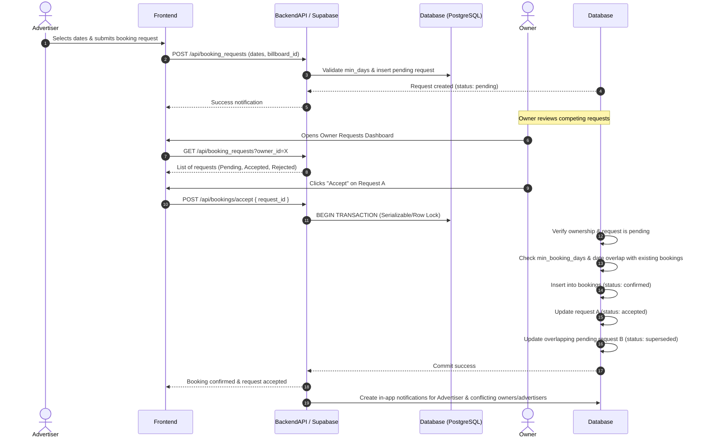

# Owner-Side Booking Request Workflow (Backend Architecture)

## 1. Complete Request Lifecycle

The lifecycle of an advertising booking request moves through distinct stages from initial submission to final fulfillment or cancellation:

1. **Submitted (`pending`)**: 
   - An advertiser selects a billboard, specifies a date range (`start_date`, `end_date`), provides a campaign name and optional message, and submits a request.
   - The request is saved in the `booking_requests` table with `status = 'pending'`.
   - Concurrently, the system validates that the requested dates meet the billboard's `min_booking_days` and do not overlap with existing confirmed bookings (`bookings` table where `status = 'confirmed'`).
   - Other `pending` requests may overlap, as pending requests do not automatically block submissions.

2. **Under Review (`pending`)**:
   - The owner views competing requests for their billboard in the owner requests dashboard (`/owner/requests`).
   - The owner evaluates commercial terms, campaign suitability, and dates across overlapping requests.

3. **Accepted (`accepted`)**:
   - The owner selects a request and clicks **Accept**.
   - The backend runs an atomic PostgreSQL transaction (or RPC function) ensuring:
     - The requesting user is the billboard owner.
     - The request exists and is still `pending`.
     - No confirmed booking conflicts with the requested date range.
   - Upon success:
     - The request status is updated to `accepted`.
     - A corresponding entry is inserted into the `bookings` table (`status = 'confirmed'`).
     - The advertiser is notified in-app.

4. **Rejected (`rejected`)**:
   - The owner clicks **Reject**, optionally attaching a message (e.g. suggesting an alternative date or alternative billboard).
   - The request status is updated to `rejected`, and `owner_response` is stored.
   - The advertiser is notified in-app.

5. **Conflict Ineligible / Superseded (`superseded` / `ineligible`)**:
   - When Request A is accepted, any other pending requests (e.g., Request B) whose requested date ranges overlap with Request A's confirmed booking date range become **ineligible**.
   - **Recommended Approach**: Conflicting pending requests remain in the system with their status updated to `superseded` (or `ineligible`) with an automated explanation ("This request can no longer be accepted because the billboard is now booked for these dates"). This prevents misleading expectations while keeping the history transparent for the advertiser and owner.

6. **Cancelled (`cancelled`)**:
   - An advertiser may cancel their pending request before it is accepted or rejected by the owner.

---

## 2. Proposed Request and Booking Statuses

### Request Statuses (`booking_requests.status`)
- `pending`: Awaiting owner review.
- `accepted`: Approved by the owner; resulted in a confirmed booking.
- `rejected`: Declined by the owner.
- `superseded`: Automatically marked ineligible because a conflicting booking was confirmed for those dates.
- `cancelled`: Withdrawn by the advertiser.

### Confirmed Booking Statuses (`bookings.status`)
- `confirmed`: Active confirmed booking occupying the date range.
- `completed`: Booking period has successfully concluded.
- `cancelled`: Booking cancelled post-confirmation (requires administrative or mutual agreement workflow).

---

## 3. Status-Transition Table

| Current Status | Action / Event | Target Status | Permitted Actor | Resulting Side-Effects |
|---|---|---|---|---|
| *(None)* | Advertiser submits request | `pending` | Advertiser | Row inserted in `booking_requests`; notification sent to owner |
| `pending` | Advertiser cancels | `cancelled` | Advertiser | Request status updated to `cancelled` |
| `pending` | Owner accepts | `accepted` | Billboard Owner | Atomic transaction creates record in `bookings`; conflicting pending requests marked `superseded` |
| `pending` | Owner rejects | `rejected` | Billboard Owner | Request status updated to `rejected`; optional `owner_response` saved |
| `pending` | Conflict detected (another request accepted) | `superseded` | System (Automated) | Request marked ineligible due to overlapping confirmed booking |
| `accepted` | Post-booking completion | `completed` | System / Admin | Booking status updated upon end date expiration |

---

## 4. Mermaid Sequence Diagram



---

## 5. Competing Requests and Overlapping Dates

When multiple advertisers request overlapping date ranges on the same billboard:
- **Independent Submission**: All competing requests are stored as `pending`. None block submissions.
- **Owner Discretion**: The owner reviews all requests in their dashboard. The system displays overlap warnings (e.g., highlighting requests that conflict with each other or with confirmed bookings).
- **Sequential Acceptance**:
  - If Request A (Nov 1–30) and Request B (Nov 15–Dec 15) overlap:
  - If the owner accepts Request A, a confirmed booking is created for Nov 1–30.
  - Request B now conflicts with a confirmed booking date range. The system marks Request B as `superseded` (ineligible), notifying the advertiser that those dates are no longer available.
  - Non-conflicting requests (e.g., Request C for Dec 1–31) remain fully eligible for review and acceptance.

---

## 6. Proposed Database Entities and Relationships

```
┌─────────────────────────┐       ┌─────────────────────────┐
│        profiles         │       │       billboards        │
├─────────────────────────┤       ├─────────────────────────┤
│ id (PK, references auth)│1     *│ id (PK)                 │
│ display_name            ├───────┤ owner_id (FK to profiles│
│ company_name            │       │ title, city, price, etc │
│ phone, email            │       │ min_booking_days        │
└─────────────┬───────────┘       └─────────────┬───────────┘
              │ 1                             │ 1
              │                               │
              │ *                             │ *
┌─────────────▼───────────┐       ┌─────────────▼───────────┐
│    booking_requests     │       │        bookings         │
├─────────────────────────┤       ├─────────────────────────┤
│ id (PK)                 │       │ id (PK)                 │
│ billboard_id (FK)       │       │ billboard_id (FK)       │
│ advertiser_id (FK)      │       │ advertiser_id (FK)      │
│ owner_id (FK)           │       │ owner_id (FK)           │
│ start_date, end_date    │       │ booking_request_id (FK) │
│ campaign_name, message  │       │ start_date, end_date    │
│ status (pending/etc.)   │       │ amount, currency        │
│ owner_response          │       │ status (confirmed/etc.) │
└─────────────────────────┘       └─────────────────────────┘
```

---

## 7. Backend Operations for Accepting and Rejecting Requests

### Accepting a Request (RPC / Transaction)
1. **Authentication Check**: Verify JWT corresponds to the authenticated user.
2. **Ownership Validation**: Query `billboards` where `id = request.billboard_id` and `owner_id = auth.uid()`.
3. **Status Check**: Verify `booking_requests` where `id = request_id` and `status = 'pending'`.
4. **Duration & Availability Check**:
   - Verify `(end_date - start_date + 1) >= billboard.min_booking_days`.
   - Check `EXISTS` query on `bookings` where `billboard_id = req.billboard_id`, `status = 'confirmed'`, and date ranges overlap (`start_date <= req.end_date AND end_date >= req.start_date`).
5. **Atomic Commit**:
   - Insert confirmed booking into `bookings`.
   - Update `booking_requests` set `status = 'accepted'`.
   - Update any other pending requests for the same billboard overlapping these dates to `status = 'superseded'`.

### Rejecting a Request
1. **Authentication Check**: Verify authenticated user owns the billboard.
2. **Update Operation**: Update `booking_requests` set `status = 'rejected'`, `owner_response = optional_message`, `responded_at = NOW()` where `id = request_id`.

---

## 8. Transaction and Concurrency Requirements

- **Mechanism**: PostgreSQL PL/pgSQL function (`SECURITY DEFINER`) or transaction block with `SERIALIZABLE` isolation level / explicit row locking (`SELECT ... FOR UPDATE` on `billboards`).
- **Rationale**: Prevents race conditions where two owner sessions or rapid duplicate submissions attempt to confirm overlapping bookings simultaneously. The database ensures atomicity so that only one overlapping booking can be confirmed.

---

## 9. RLS and Authorization Requirements

- **Row Level Security (RLS)**:
  - `booking_requests`: Advertisers can insert and view their own requests (`advertiser_id = auth.uid()`). Owners can view and update requests where `owner_id = auth.uid()`.
  - `bookings`: Accessible by the respective advertiser (`advertiser_id = auth.uid()`) and owner (`owner_id = auth.uid()`).
  - `billboards`: Publicly readable (`is_visible = true`), owner-editable (`owner_id = auth.uid()`).
- **Authorization Enforcement**: Database functions run with security constraints verifying `auth.uid()` against `owner_id`. Frontend parameters cannot override ownership.

---

## 10. Notification and Message Handling

- **In-App Notifications**:
  - Create a lightweight `notifications` table (`id`, `user_id`, `title`, `message`, `read`, `created_at`).
  - Triggered on status transitions (accepted, rejected, superseded).
- **Public vs. Private Data**:
  - Owner phone numbers and public billboard details are publicly accessible.
  - Booking requests, financial amounts, internal owner notes, and private messages remain strictly restricted to authorized parties via RLS.

---

## 11. Edge Cases and Failure Scenarios

- **Concurrent Acceptance**: Two owners/admins trying to accept conflicting requests at the same second — handled via atomic database transaction and row-level locking.
- **Owner Changes Minimum Duration After Request**: If `min_booking_days` is increased after an advertiser submitted a request, the backend validation at acceptance time evaluates against current billboard rules. If invalid, the owner is prompted to reject the request with an explanation or update terms.
- **Network Failure Mid-Request**: Transactions roll back automatically; no partial state or orphan bookings are created.

---

## 12. Recommended Automated Tests

1. **Unit Tests (Vitest)**: Date range overlap algorithms, minimum duration validation utilities.
2. **Integration Tests (Supabase / PostgreSQL)**:
   - Verify that confirming Booking A successfully marks overlapping Pending Request B as `superseded`.
   - Verify that non-overlapping Request C remains `pending`.
   - Verify RLS enforcement preventing non-owners from accepting requests.

---

## 13. Unresolved Business Decisions Requiring Approval

1. **Automatic Expiry**: Should pending requests automatically expire after a certain number of days (e.g., 7 days) if the owner does not respond?
2. **Alternative Proposals**: When rejecting a request with an alternative billboard, should the system generate a new draft inquiry for the advertiser, or leave it as a text message in `owner_response`?
